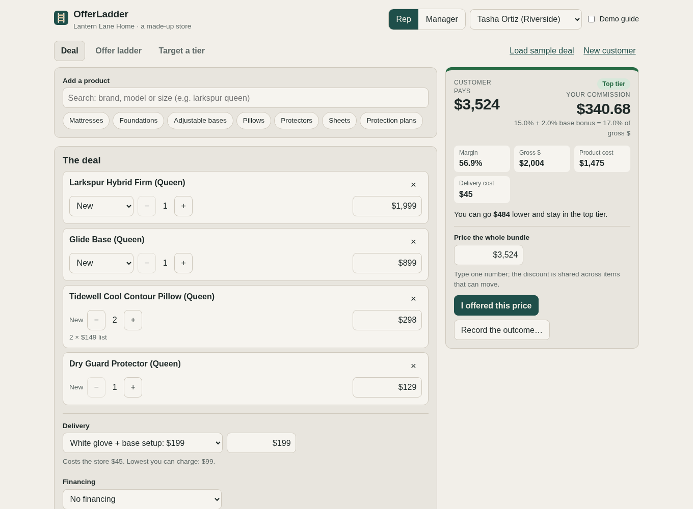
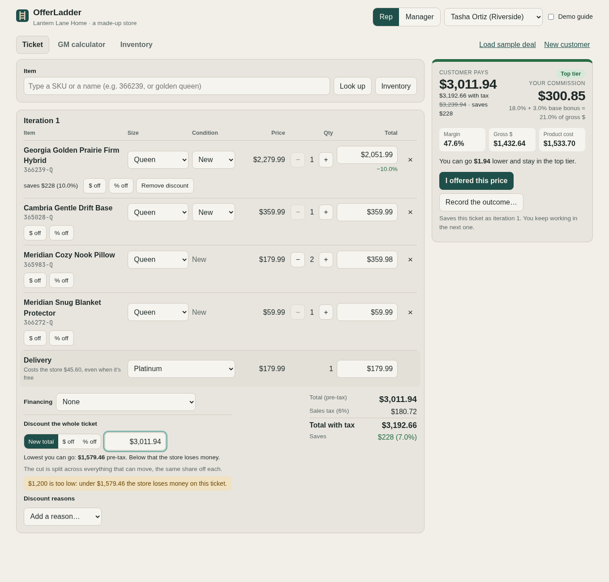
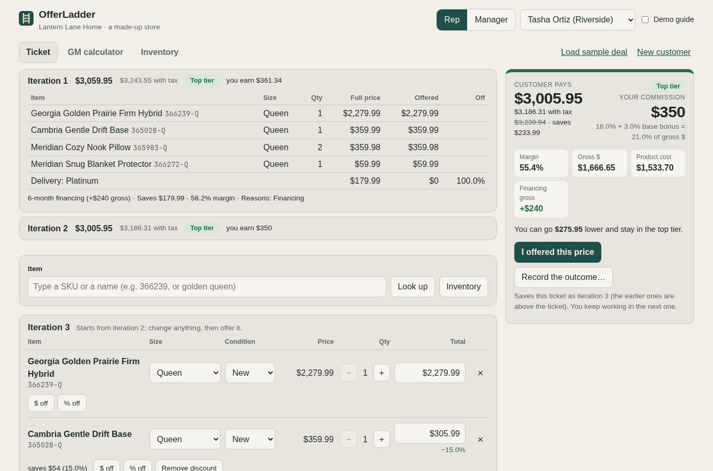
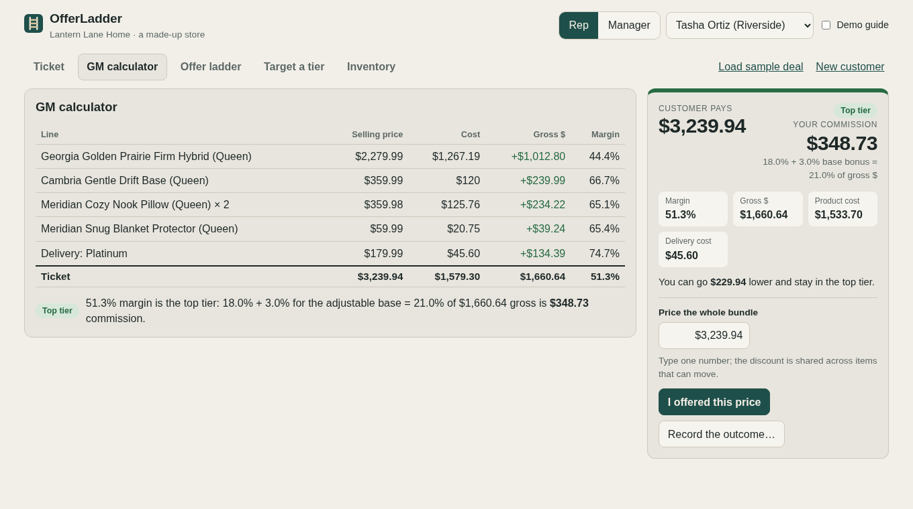
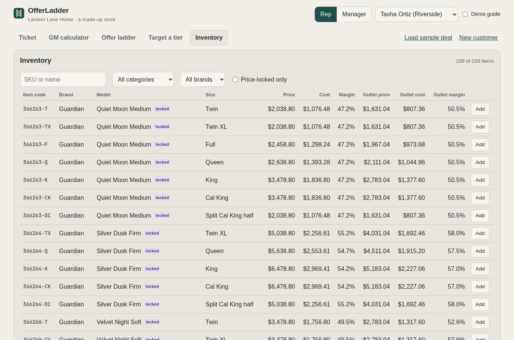
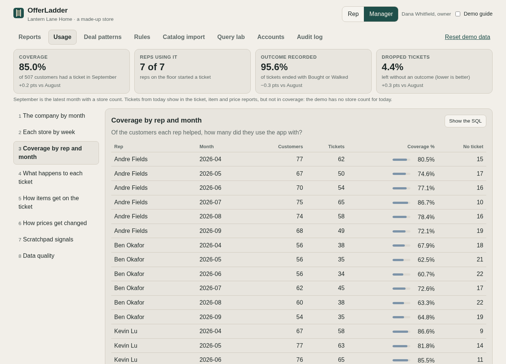
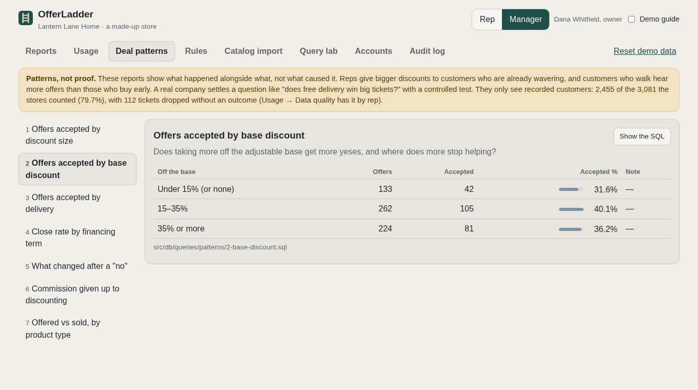
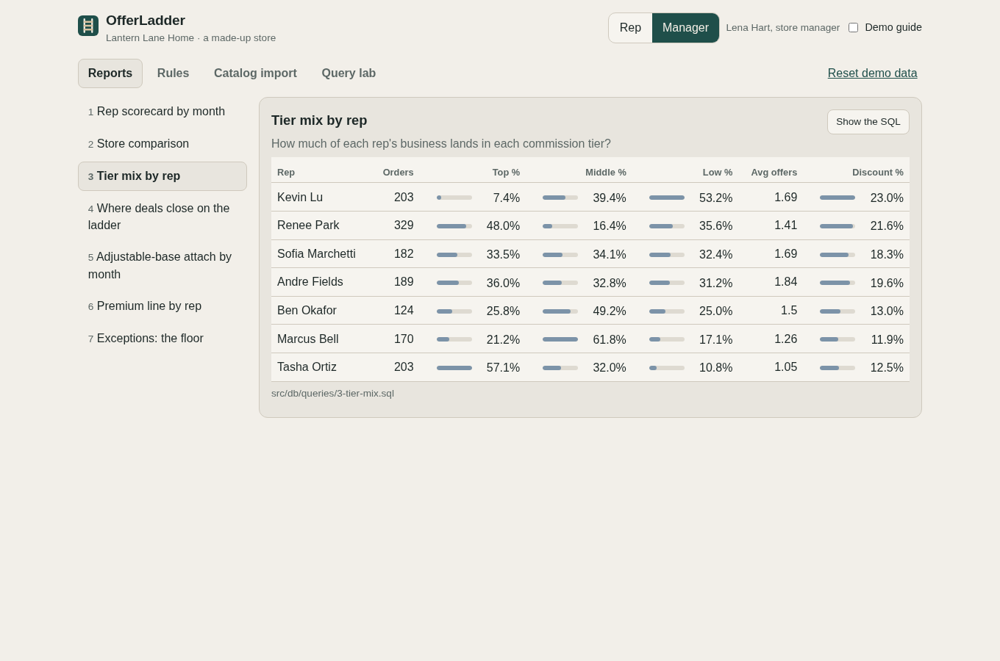
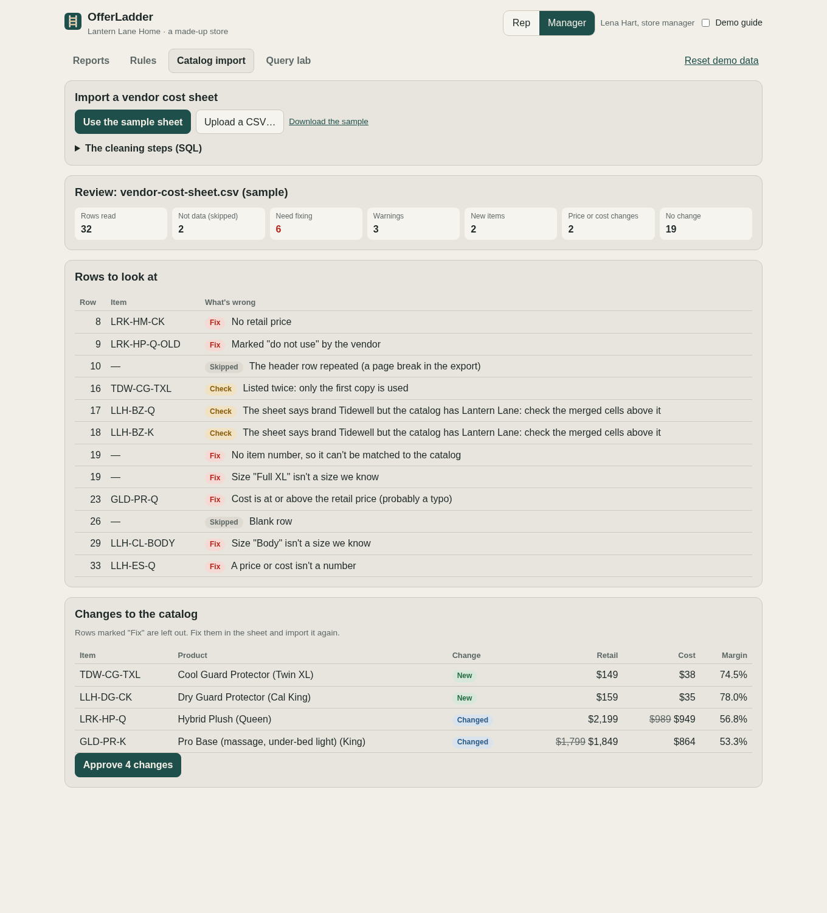

# OfferLadder

**Live demo: https://lyversemason.github.io/offer-ladder/** (no login: switch between Rep and Manager)

OfferLadder is a commission and negotiation calculator for retail sales floors. Managers
set the pricing and commission rules. Reps build the customer's ticket like a point-of-sale
screen and negotiate inside the rules, seeing what every price does to their tier and
commission as they type. Every offer is saved as an iteration, and every deal lands in a
SQL database that the manager's reports read.

It doesn't tell a rep what to offer or how to pitch it. The rep reads the customer; the
app does the math and shows the consequences.

Managers also see how the app is used (with how many of their customers each rep uses
it, how they build offers, what goes unrecorded) and what happens with customers
depending on what's offered, labeled as patterns, not proof.

It's a public rebuild and expansion of a tool I built and used as a salesperson and
assistant manager at a mattress and furniture retailer (7 reps across 2 stores used the
original). This version is fresh code with a **fictional store, Lantern Lane Home**, and
fictional people. Its catalog and rules are modeled on a real 2025 showroom lineup (the
sizes, which lines are price-locked, how price relates to cost, the commission tiers and
the financing chart), with every brand, product name, SKU and dollar amount disguised.



## Try it in two minutes

Turn on **Demo guide** (top right) for a short explanation on each screen.

1. **Rep → Load sample deal.** A ticket like a point-of-sale screen: a queen hybrid
   mattress, an adjustable base, two pillows, a protector and Platinum delivery: $3,239.94
   ($3,434.34 with 6% tax), top tier, $348.73 commission. Type a SKU (try `366263`) or a
   name in the item box, or use **Look up**. Change a size, condition or total on any row
   and watch the tier and commission move. **GM calculator** shows every line's gross and
   margin.
2. **Discount something.** **$ off** or **% off** on a row, or type a new total. Or
   discount the whole ticket at once: the cut is shared across everything that can move,
   and the lowest price the store allows is shown right under it. Add the reasons you
   gave the customer (financing, military, a Google review…).
3. **I offered this price.** The ticket is saved as Iteration 1 and folds up above; you
   keep working in Iteration 2. Open an earlier one to see exactly what you offered.
4. **Record the outcome… → Sold.** Then switch to **Manager → Reports**: the sale is in
   this month's scorecard.
5. **Manager → Catalog import → Use the sample sheet.** A messy vendor cost sheet goes
   through six SQL cleaning steps; review the flagged rows and approve the changes.

Everything you do is saved in your browser only. **Reset demo data** puts it back.

## What a discount costs the rep

Commission is paid on **gross profit dollars**, at a rate set by the deal's margin tier
(top tier 47.5%+ margin pays 18%, middle 43–47.49% pays 14%, low pays 10% down to a 0.01%
floor, plus 3 points when the sale includes an adjustable base). The floor is the store's
rule: make the sale as long as it makes money, even a dollar; break-even or a loss is
blocked. Any one item can go below its cost or even be free, as long as the whole ticket
makes money. Every delivery costs the store the same amount, even a free one, and it comes
out of gross dollars (pickup costs nothing). A discount hits the rep twice: a lower rate,
on fewer dollars.

Where prices land for the sample deal (the app shows these as the rep types):

| | Customer pays | With tax | Tier | Rep earns |
|---|---|---|---|---|
| Full price | $3,239.94 | $3,434.34 | Top | $348.73 |
| Lowest in the top tier | $3,010 | $3,190.60 | Top | $300.45 |
| Lowest in the middle tier | $2,780 | $2,946.80 | Middle | $204.12 |
| The exceptions margin (20%) | $1,980 | $2,098.80 | Low | $52.09 |
| Lowest the store allows | $1,579.46 | $1,674.23 | Low | $0.02 |

The first $230 off costs the rep $48. The next $230 drops the deal into the middle tier
and costs $96, because the rate falls and the dollars shrink at the same time. Going from
47.5% to 43% margin already takes a lot off the price. Anything under the exceptions
margin (20%) is allowed, but it shows up in the manager's exceptions report.

## What it does

| | |
|---|---|
| **Point-of-sale ticket** | Type a SKU or part of a name and pick from the matches (arrow keys and Enter work), or **Look up** by category → brand → model → size. Each row's size, condition (new or outlet), quantity and total change in place; delivery is a line of its own. **Inventory** lists every item with its price, cost and margin, new and outlet. |
| **GM calculator** | Every line, delivery included, with its selling price, cost, gross dollars and margin, then the ticket's totals and how they become the commission. A free pillow shows as a loss; only the whole ticket has to make money. |
| **Discounts like a point of sale** | On one row: dollars off, percent off or a new total, with what it saves in dollars and percent and a button to remove it. On the whole ticket: a new total, dollars off or percent off, shared across everything that can move (price-locked items stay at list), with the lowest price the store allows shown under it. A price that would lose the store money is refused, with the lowest that works. |
| **Iterations** | Each price the rep offers freezes the whole ticket as Iteration 1, 2, 3…: folded up above the ticket, opens to show every line, and can't be changed. The rep always works in the next one. Each keeps the discount reasons the rep gave (financing, military, healthcare, a Google review…). |
| **Live deal readout** | What the customer pays (before and with sales tax) and saves, margin, gross dollars, financing gross, tier and commission as the rep types; how much lower the rep can go and stay in the tier, and what it takes to get back up one. |
| **Rules a rep can't break** | Price-locked models sell at list (the margin has to come from the rest of the bundle); a premium mattress only goes on its own brand's foundation or base (the maker's warranty rule); one item can go below its cost or even free, but the whole ticket has to make money (break-even or a loss is blocked); an outlet piece never sells above 20% off; delivery can't go below its minimum; financing only at amounts it's offered. |
| **Manager rules** | Tiers, rates, the attach bonus, sales tax, the exceptions margin, delivery cost and options, the financing chart, which models are price-locked. Broken rules can't be saved, and each change shows its effect on a sample deal before saving. |
| **SQL reports** | Seven sales reports, each a plain `.sql` file with a plain-English header: rep scorecard by month (ups, conversion, average order, margin, attach, commission, comp %), store comparison, tier mix, where deals close on the ladder, attach trend, premium-line share, exceptions (who closes under the exceptions margin). **Show the SQL** shows the exact query. |
| **Usage (managers)** | Is the app being used, and how? **Coverage**: tickets ÷ the store's own count of customers, per rep, week and month. What happens to each ticket, how items get added, how prices get changed, scratchpad signals (prices tried vs offers recorded), and data quality (how many walk-outs go unrecorded). Built from a usage log of meaningful actions, never keystrokes. |
| **Deal patterns (managers)** | Offers accepted by discount size, base discount and delivery; close rate by financing term; what changed after a "no"; commission given up to discounting; offered vs sold. Always shown with "patterns, not proof" and how much of the floor the data sees. Reps never see odds or suggestions. |
| **Vendor data import** | A messy cost sheet (merged cells, abbreviations, money as text, repeated headers, duplicates, "do not use" rows, typos) is cleaned in six numbered SQL steps. Problems are flagged instead of guessed, and nothing changes in the catalog until the manager approves. |
| **Query lab** | Run your own read-only `SELECT` against the demo data. Writes are refused. |
| **Phone layout** | Reps use it on the sales floor: one column, with price, tier and commission pinned to the bottom of the screen. |

<table>
<tr>
<td></td>
<td></td>
</tr>
<tr>
<td>Discounts on a row and on the whole ticket, with the lowest price the store allows.</td>
<td>An earlier iteration, frozen exactly as it was offered.</td>
</tr>
<tr>
<td></td>
<td></td>
</tr>
<tr>
<td>The GM calculator: gross and margin for every line, delivery included.</td>
<td>The inventory: every item, new and outlet, with its margin.</td>
</tr>
<tr>
<td></td>
<td></td>
</tr>
<tr>
<td>Usage: with how many of their customers each rep uses the app.</td>
<td>Deal patterns: 15–35% off the base gets more yeses; deeper adds nothing.</td>
</tr>
<tr>
<td></td>
<td></td>
</tr>
<tr>
<td>Reports run on SQL: one rep's business sits mostly in the low tier.</td>
<td>The vendor import flags what a person must fix before anything changes.</td>
</tr>
</table>

## The data

- **239 items: 42 models in their real sizes** from eight made-up brands: mattresses,
  foundations, adjustable bases, a frame, pillows, sheets and protectors. Each item code
  is the model's SKU plus a size code (every size shares the SKU, as on a vendor's cost
  sheet). Bigger pieces can also be sold as outlet (pre-owned) pieces: they cost the store less,
  and they're priced 20% off new, never more. The
  Guardian premium line is price-locked, and its mattresses only go on Guardian
  foundations and bases.
- **Six months of history** (April–September 2026): about 3,100 customers counted by the
  stores, 2,450 of them recorded in the app, and 1,250 sales by 7 reps at 2 stores, every
  sale priced by the same engine the app uses. The reps differ on purpose so the reports
  tell a story: one attaches adjustable bases and holds margin, one discounts too early,
  one converts best on small tickets, one sells the premium line with full-price add-ons,
  and a new hire improves month by month.
- **The usage log behind it** (about 30,000 actions): every offer line by line, and tool
  habits per rep (one uses the app with nearly every customer, one skips recording a
  quarter of his walk-outs, one tries many prices and records few, the new hire moves from
  Look up to typed SKUs).
- **The deal patterns are planted.** The simulator builds in three customer patterns
  (free delivery on big tickets, 6-month financing, 15–35% off the base), each working
  through something the app records, so the Deal patterns reports have something real
  to find. On real data they would be patterns to test, not proven causes.

## How it's built

```
src/engine/   the money math only: pricing, tax, tiers, commission, rules, the discount
              formula, the lowest sellable price. No screens, no database. (ladder.ts
              only drives the made-up history's reps.)
src/db/       schema.sql, the SQLite module, queries/*.sql (one file per report;
              queries/postgres/ holds the Postgres versions where the two differ)
supabase/     the same tables in Postgres (migrations/), for a local Supabase in Docker
server/       the live server function: checks who's asking, prices a sale again, saves it
scripts/      load the demo into Postgres, run a report there, screenshots
src/import/   the CSV reader and the six cleaning steps (steps/*.sql)
src/data/     the disguised catalog and rules, company, history generator, sample vendor sheet
src/source/   the data source: everything the screens read and write, in one place (the
              demo's browser database today; live mode's server later)
src/ui/       the screens; they call the engine and never do money math themselves
tests/        Vitest: the math, every rule, the reports, the import, the data
docs/         SQL-GUIDE.md (every query explained line by line), screenshots
```

- **Money is whole cents and percents are basis points** (50% = 5,000), so no rounding
  drift: the same deal always pays the same commission. A tier boundary is checked with
  multiplication, so 49.999% can never round up into the 50% tier.
- **The discount formula.** If every cut comes off the price (costs stay put), the biggest
  discount that keeps margin at or above a target *t* is **D = (gross − t × price) ÷ (1 − t)**.
  So every way of spreading a discount lands on the same lowest price for a tier; only
  things that change cost or gross (outlet pieces, financing, adding full-price items) go
  lower. The "stay in this tier" prices are rounded up to whole $10 and re-checked by the
  engine; the lowest price the store allows is exact to the cent.
- **A sale is a snapshot.** Each saved deal keeps the totals and the rate used that day,
  like payroll does, so changing a rate next month doesn't rewrite last month.
- **SQLite runs in the browser** (sql.js), so the demo needs no server. The same queries
  run in the tests in Node.
- **The same tables run in Postgres** (a local Supabase in Docker), with stricter types
  and rules: real dates and booleans, CHECK rules, an add-only usage log enforced by a
  trigger, row-level security on every table. The demo history loads into it, and a test
  runs every report on both databases and checks the answers match.
  [docs/database.md](docs/database.md) explains both.
- **Tests:** 290+ automated tests (plus 39 that check the Postgres version), including 200 random deals checked for "meets the
  target, passes every rule, and $10 lower would not", every report checked against
  numbers computed separately in TypeScript, every planted problem in the sample vendor
  sheet, and a guard that fails the build if a real retailer's or brand's name appears
  anywhere in the repo (it stores only fingerprints of the names).
- **Deploys only when everything passes:** GitHub Actions runs type checks, lint and tests,
  then publishes to GitHub Pages.

### How I built it

I don't hand-code. I built this by directing AI coding agents (Claude Code), the same way
I'd run a project with a team: a written plan first ([PLAN.md](PLAN.md)), then the engine
with its tests before any screens, then the screens, with each milestone a tagged version
in the [CHANGELOG](CHANGELOG.md). The SQL layer was built by a second agent in parallel, in
its own copy of the repo, and merged when its tests passed. Every version was clicked
through in a real browser, as a rep and as a manager, at desktop and phone size, and the
problems found that way were fixed before moving on.

The SQL was written by an agent under my direction. I can read and explain every query:
[docs/SQL-GUIDE.md](docs/SQL-GUIDE.md) walks through each one line by line.

## Run it locally

```
npm install
npm run dev        # http://localhost:5173
npm run check      # type check, lint, all tests
```

The Postgres version (needs Docker, no account):

```
npm run db:start   # start the local database
npm run db:reset   # create the tables and load the demo history
npm run test:db    # check it against the browser's SQLite
npm run db:report usage-coverage   # run one report on Postgres
npm run dev:live   # the app signed in for real: http://127.0.0.1:10014
npm run db:stop
```

MIT licensed. The store, its people and all names are fictional; every dollar amount is disguised.
