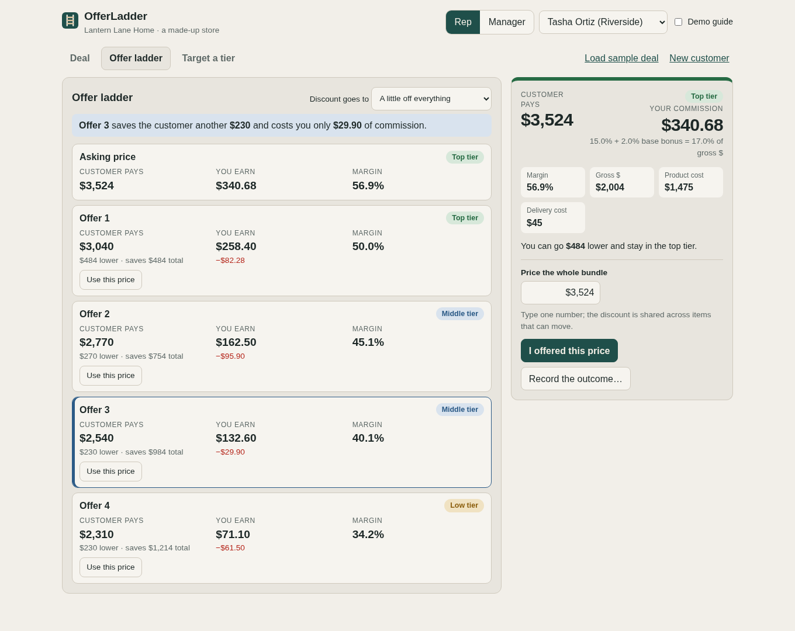
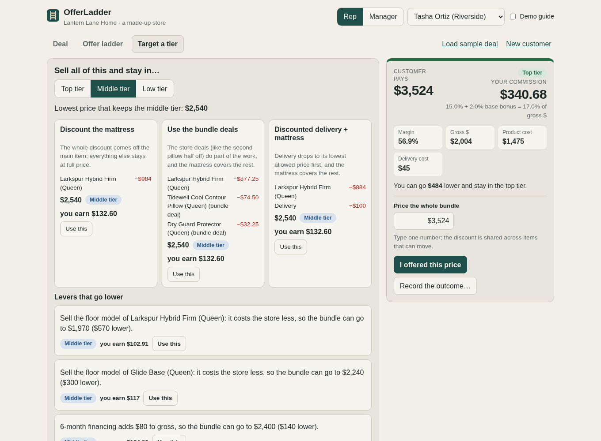

# OfferLadder

**Live demo: https://lyversemason.github.io/offer-ladder/** (no login: switch between Rep and Manager)

OfferLadder is a commission and negotiation calculator for retail sales floors. Managers
set the pricing and commission rules; reps negotiate inside them with the math done for
them; every deal lands in a SQL database that the manager's reports read.

It's a public rebuild and expansion of a tool I built and used as a salesperson and
assistant manager at a mattress and furniture retailer (7 reps across 2 stores used the
original). This version is fresh code with a **fictional store, Lantern Lane Home**:
every brand, product, cost, price, commission rate and person is made up.



## Try it in two minutes

Turn on **Demo guide** (top right) for a short explanation on each screen.

1. **Rep → Load sample deal.** A queen mattress, an adjustable base, two pillows, a
   protector and white-glove delivery: $3,524, top tier, $340.68 commission. Type a lower
   price on any item and watch the tier and commission move.
2. **Offer ladder.** The offers a rep would actually make, in order, with the commission
   given up at each step. **Use this price** on Offer 2, then **I offered this price**.
3. **Target a tier → Middle.** The lowest price that keeps the middle tier, three ways to
   present it, and the levers that really go lower (floor model, financing, a full-price
   add-on).
4. **Record the outcome… → Sold.** Then switch to **Manager → Reports**: the sale is in
   this month's scorecard.
5. **Manager → Catalog import → Use the sample sheet.** A messy vendor cost sheet goes
   through six SQL cleaning steps; review the flagged rows and approve the changes.

Everything you do is saved in your browser only. **Reset demo data** puts it back.

## A worked negotiation

Commission is paid on **gross profit dollars**, at a rate set by the deal's margin tier
(made-up demo rules: top tier 50%+ margin pays 15%, middle 40–49.99% pays 11%, low
34–39.99% pays 7%, plus 2 points when the sale includes an adjustable base). A discount
hits the rep twice: a lower rate, on fewer dollars.

The sample deal's ladder:

| | Customer pays | Tier | Rep earns | This step costs the rep |
|---|---|---|---|---|
| Asking price | $3,524 | Top | $340.68 | |
| Offer 1 | $3,040 | Top | $258.40 | $82.28 |
| Offer 2 | $2,770 | Middle | $162.50 | $95.90 for $270 off |
| Offer 3 | $2,540 | Middle | $132.60 | **$29.90 for $230 off** |
| Offer 4 (final) | $2,310 | Low | $71.10 | $61.50 |

That's the method the tool was built around. One offer keeps the top tier. The next real
discount drops into the middle tier, and that's the expensive step. But the middle tier is
wide, so a third significant discount costs the rep very little: here $230 more off the
customer's price costs $29.90 of commission. Dropping into the low tier is the final offer.
Every step is at least the minimum step ($100 or 5%), because a tiny discount insults the
customer.

## What it does

| | |
|---|---|
| **Live deal readout** | What the customer pays and saves, margin, gross dollars, tier and commission as the rep types; how much lower the rep can go and stay in the tier; type one bundle price and the discount is shared across the items that can move. |
| **Offer ladder** | Opening top-tier offer → middle-tier offers → final offer at the floor, with the commission given up at every step, a callout for the cheapest step, and a choice of where the discount goes (spread, mattress first, delivery first). |
| **Target a tier** | "Sell all of this and stay in the middle tier": the lowest price that holds it, 2–3 ways to present it, and levers that go lower: sell the floor model (lower cost), a financing term that adds gross dollars, or a full-price add-on of the right size that lifts the bundle. |
| **Rules a rep can't break** | Price-locked premium lines sell at list (the margin has to come from the rest of the bundle); nothing below cost; nothing below the margin floor; delivery can't go below its minimum; financing only at amounts it's offered; a warning before a lowball step. |
| **Manager rules** | Tiers, rates, the attach bonus, minimum step, rounding, delivery cost and options, bundle deals, the financing chart, price-locked brands and categories. Broken rules can't be saved, and each change shows its effect on a sample deal before saving. |
| **SQL reports** | Seven reports, each a plain `.sql` file with a plain-English header: rep scorecard by month (ups, conversion, average order, margin, attach, commission, comp %), store comparison, tier mix, where deals close on the ladder, attach trend, premium-line share, exceptions at the floor. **Show the SQL** shows the exact query. |
| **Vendor data import** | A messy cost sheet (merged cells, abbreviations, money as text, repeated headers, duplicates, "do not use" rows, typos) is cleaned in six numbered SQL steps. Problems are flagged instead of guessed, and nothing changes in the catalog until the manager approves. |
| **Query lab** | Run your own read-only `SELECT` against the demo data. Writes are refused. |
| **Phone layout** | Reps use it on the sales floor: one column, with price, tier and commission pinned to the bottom of the screen. |

<table>
<tr>
<td></td>
<td></td>
</tr>
<tr>
<td>The deal and the live readout.</td>
<td>Target a tier: the same lowest price three ways, plus levers that go lower.</td>
</tr>
<tr>
<td></td>
<td></td>
</tr>
<tr>
<td>Reports run on SQL: one rep's business sits mostly in the low tier.</td>
<td>The vendor import flags what a person must fix before anything changes.</td>
</tr>
</table>

## The data

- **54 products** from six made-up brands, some with floor-model and clearance versions
  (each with its own cost). The "Kestrel" premium line is price-locked and sits in the
  middle tier at list price, so selling it well depends on the rest of the bundle.
- **Six months of history** (April–September 2026): about 3,100 customers helped and
  1,440 sales by 7 reps at 2 stores, every sale priced by the same engine the app uses.
  The reps differ on purpose so the reports tell a story: one attaches adjustable bases
  and holds margin, one discounts too early, one converts best on small tickets, one
  sells the premium line with full-price add-ons, and a new hire improves month by month.

## How it's built

```
src/engine/   the money math only: pricing, tiers, commission, rules, the discount
              formula, the offer ladder, target mode. No screens, no database.
src/db/       schema.sql, the SQLite module, queries/*.sql (one file per report)
src/import/   the CSV reader and the six cleaning steps (steps/*.sql)
src/data/     the made-up catalog, rules, company, history generator, sample vendor sheet
src/ui/       the screens; they call the engine and never do money math themselves
tests/        Vitest: the math, every rule, the reports, the import, the data
docs/         SQL-GUIDE.md (every query explained line by line), screenshots
```

- **Money is whole cents and percents are basis points** (50% = 5,000), so no rounding
  drift: the same deal always pays the same commission. A tier boundary is checked with
  multiplication, so 49.999% can never round up into the 50% tier.
- **The discount formula.** If every cut comes off the price (costs stay put), the biggest
  discount that keeps margin at or above a target *t* is **D = (gross − t × price) ÷ (1 − t)**.
  So every lever that only moves price lands on the same lowest bundle price; only levers
  that change cost or gross (floor models, financing, adding full-price items) go lower.
  Offers are rounded up to whole $10 and re-checked by the engine.
- **A sale is a snapshot.** Each saved deal keeps the totals and the rate used that day,
  like payroll does, so changing a rate next month doesn't rewrite last month.
- **SQLite runs in the browser** (sql.js), so the demo needs no server. The same queries
  run in the tests in Node.
- **Tests:** 170+ automated tests, including 200 random deals checked for "meets the
  target, passes every rule, and $10 lower would not", every report checked against
  numbers computed separately in TypeScript, every planted problem in the sample vendor
  sheet, and a guard that fails the build if a real retailer's or brand's name appears
  anywhere in the repo (it stores only fingerprints of the names).
- **Deploys only when everything passes:** GitHub Actions runs type checks, lint and tests,
  then publishes to GitHub Pages.

### How I built it

I don't hand-code. I built this by directing AI coding agents (Claude Code), the same way
I'd run a project with a team: a written plan first ([PLAN.md](PLAN.md)), then the engine
with its tests before any screens, then the screens, with each milestone a tagged version
in the [CHANGELOG](CHANGELOG.md). The SQL layer was built by a second agent in parallel, in
its own copy of the repo, and merged when its tests passed. Every version was clicked
through in a real browser, as a rep and as a manager, at desktop and phone size, and the
problems found that way were fixed before moving on.

The SQL was written by an agent under my direction. I can read and explain every query:
[docs/SQL-GUIDE.md](docs/SQL-GUIDE.md) walks through each one line by line.

## Run it locally

```
npm install
npm run dev        # http://localhost:5173
npm run check      # type check, lint, all tests
```

MIT licensed. All data is fictional.
